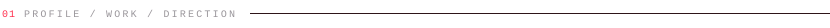

 

<a href="https://jaumns.github.io/Jaumns/"><strong>↗ OPEN INTERACTIVE PROFILE — red pool / code tracker / lab</strong></a>

&nbsp;&nbsp;&nbsp;&nbsp;
 

 

 

 

 
&nbsp;
 
&nbsp;
 
&nbsp;
 

 

 

 

 

