<picture></picture>

&nbsp;&nbsp;&nbsp;&nbsp;

<picture></picture>

<picture></picture>

<picture></picture>

<picture></picture>

&nbsp;
 
&nbsp;
 
&nbsp;

<picture></picture>

<picture></picture>

