

<picture></picture>

&nbsp;&nbsp;&nbsp;&nbsp;


<picture>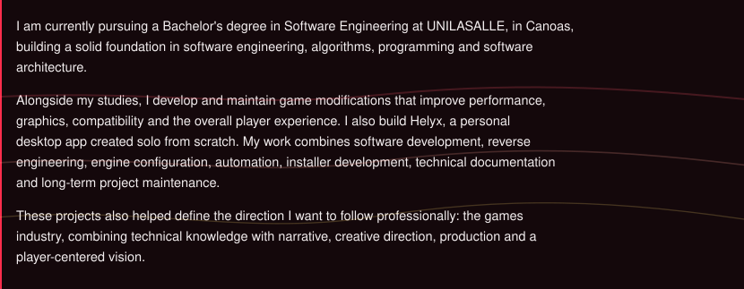</picture>
  

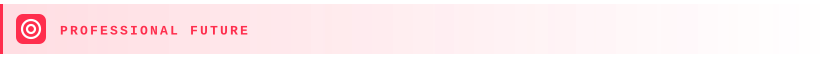

<picture>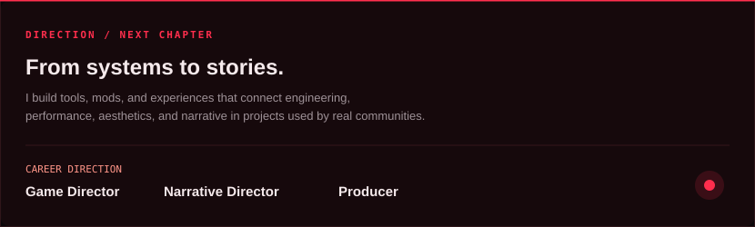</picture>
  


<picture>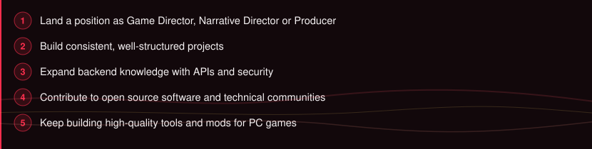</picture>
  

<picture></picture>
  

<table width="100%"><tr>
<td width="50%" valign="top"><a href="https://www.nexusmods.com/thesinkingcity/mods/25">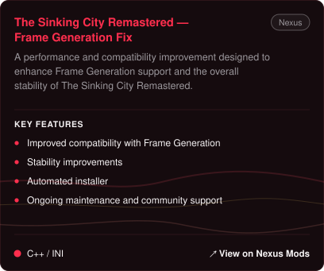</a></td>
<td width="50%" valign="top"><a href="https://www.nexusmods.com/control/mods/135">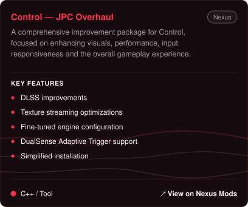</a></td>
</tr><tr>
<td width="50%" valign="top"><a href="https://www.nexusmods.com/thesinkingcity2/mods/26">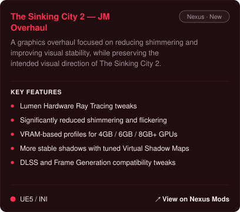</a></td>
<td width="50%" valign="top"><a href="https://jaumns.vercel.app">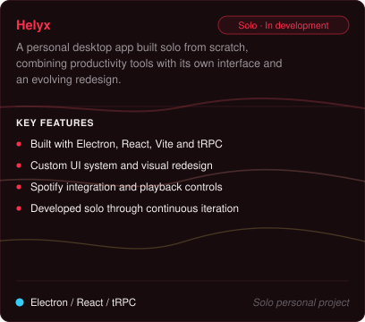</a></td>
</tr><tr>
<td width="50%" valign="top"><a href="https://jaumns.vercel.app"></a></td>
<td width="50%" valign="top"><a href="https://www.nexusmods.com/controlresonant/mods/101">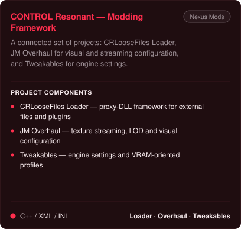</a></td>
</tr></table>
  


<table width="100%"><tr>
<td width="50%" valign="top"></td>
<td width="50%" valign="top"></td>
</tr></table>
 

  

  

  

<picture></picture>

