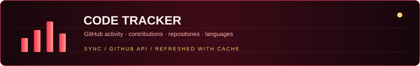

<picture></picture>

&nbsp;&nbsp;&nbsp;&nbsp;

<strong>01 / PROFILE</strong>

 
<picture></picture>
<picture></picture>

<strong>02 / STACK</strong>

 
<picture></picture>
<picture></picture>

<strong>03 / PROJECTS</strong>

 
<picture></picture>
&nbsp;
 
&nbsp;
 
&nbsp;

<strong>04 / CODE TRACKER</strong>

 
<picture></picture>
<table width="100%"><tr>
<td width="50%" valign="top"></td>
<td width="50%" valign="top"></td>
</tr></table>

<strong>05 / GOALS</strong>

 
<picture></picture>
<picture></picture>

<a href="https://jaumns.vercel.app">Portfolio</a>&nbsp;&nbsp;·&nbsp;&nbsp;<a href="https://github.com/Jaumns?tab=repositories">All repositories</a>&nbsp;&nbsp;·&nbsp;&nbsp;<a href="https://open.spotify.com/user/wlgoih8yr7pimasv1bkz58gha">Spotify</a>

<picture></picture>

